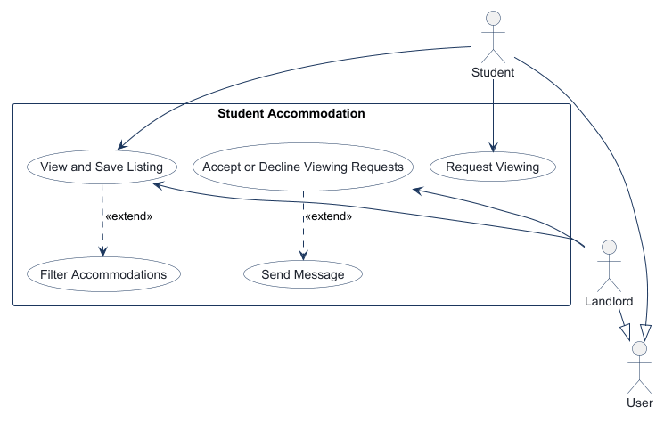
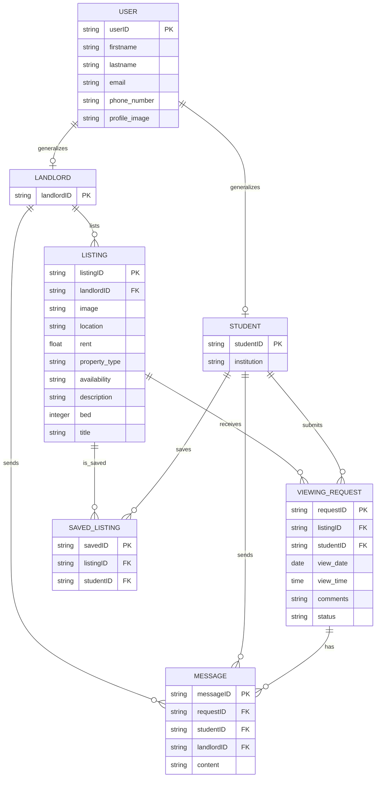
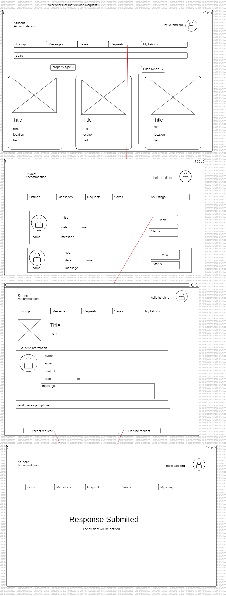
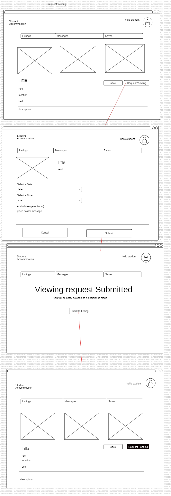
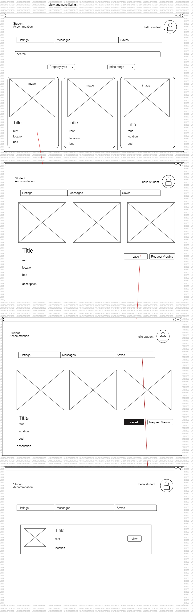

<!-- student-build:skill-integrity
status: pass
root: e84cd692d0b85eefe546385661958c27d07e8be6c5176a82012f68ccff5c8beb
expected_root: e84cd692d0b85eefe546385661958c27d07e8be6c5176a82012f68ccff5c8beb
mismatches: none
-->

# COMP 3613 Assignment 1

Draft this file with the Guide. **Update it after every phase milestone** before you pause. The use-case diagram is a UML PNG at `docs/diagrams/use-case.png`, linked from this file as `diagrams/use-case.png` (path relative to `docs/report.md`). The model diagram is Mermaid. **Embed wireframe images** as `wireframes/<file>` (files live in `docs/wireframes/`).

Do not put your student ID in this file if you will commit it. The PDF cover adds your name and ID at export time.

## Assigned project

Student Accommodation

## Problem interpretation

CampusNest helps students find student accommodation, save listings, and request
viewings. Landlords can review viewing requests for their own listings and accept
or decline them. The implementation reuses the FastStarter authentication and
role system, with students represented by regular users and landlords represented
by admin users.

## Three workflows

### 1. View and Save Listing (User)

An authenticated user browses listing cards, filters the available
accommodation, opens listing details, and saves or unsaves a listing. The saved
listings remain available from the authenticated navigation.

### 2. Request Viewing (Student)

An authenticated student opens a listing detail page, selects a requested date
and time, adds an optional comment, and submits a viewing request. The request
starts in the `pending` state.

### 3. Accept or Decline Viewing Requests (Landlord)

An authenticated landlord reviews requests for the landlord's own listings and
accepts or declines a pending request. After the decision, the status is shown
and the decision controls are replaced by a completed-state message.
## Use case diagram

Phase 2 notes: User is the general actor, with Student and Landlord specializing
User. View and Save Listing is shared by Student and Landlord. Request Viewing is
Student-only, and Accept or Decline Viewing Requests is Landlord-only. View and
Save Listing extends Filter Accommodations, and Accept or Decline Viewing
Requests extends Send Message.

## Model diagram

Updated through the Phase 4 model review. Names are normalized from the supplied
list where needed: `Listing`, `ViewingRequest`, `SavedListing`, `listingID`,
`landlordID`, `studentID`, `availability`, `bed`, `title`, and `profile_image`.

`USER` is abstract. It owns the shared `firstname`, `lastname`, `email`,
`phone_number`, and `profile_image` properties; `STUDENT` and `LANDLORD`
generalize from it. `STUDENT` adds `institution`, while `LANDLORD` currently has
no additional properties. `LISTING.image` is included because the wireframes
show listing images on listing cards and the detail view.

Phase 3 relationship and rule notes: A landlord can list many listings, and each
listing belongs to one landlord. A student can submit many viewing requests, and
each request belongs to one student. A listing can receive many viewing requests,
and each request refers to one listing. A student can save many listings, and each
saved record belongs to one student. A listing can be saved by many students, and
each saved record refers to one listing. `availability` is `available` or
`unavailable`; `property_type` is `apartment`, `house`, or `shared space`; `bed`
is an integer; and `status` is `pending`, `accepted`, `declined`, or `cancelled`.
A landlord may accept multiple requests for the same viewing date.
`view_time` records the requested viewing time.

The `MESSAGE` entity is recorded here as a model decision for the messaging
extension; it is not part of the three implemented workflow slices.

## Wireframes

The student-created wireframes cover all three named workflows:

### View and Save Listing

<!-- student-build:wireframe-coverage
use_case: View and Save Listing (User)
image: docs/wireframes/view and save listing.png
covered: yes
-->

### Request Viewing

<!-- student-build:wireframe-coverage
use_case: Request Viewing (Student)
image: docs/wireframes/request viewing.png
covered: yes
-->

### Accept or Decline Viewing Requests

<!-- student-build:wireframe-coverage
use_case: Accept or Decline Viewing Requests (Landlord)
image: docs/wireframes/Accept or Decline Viewing Request.png
covered: yes
-->

### Accept or Decline Viewing Request

### request viewing

### view and save listing

## Theming

The student selected a warm, welcoming campus-living direction. The resulting
CampusNest theme uses cream and neutral backgrounds with terracotta accents and
evergreen text/actions. The brand wordmark is CampusNest and the tone is
welcoming, practical, and student-focused. The theme was applied to:

- [app/templates/landing.html](../app/templates/landing.html)
- [app/templates/login.html](../app/templates/login.html)
- [app/templates/register.html](../app/templates/register.html)
- [app/templates/authenticated-base.html](../app/templates/authenticated-base.html)
- [app/static/css/app.css](../app/static/css/app.css)

The irrelevant starter presentation was removed from the public flow while
configuration and the starter authentication/session system were retained.

## Implementation notes

### Workflow 1 — View and Save Listing (User)

Implemented as a layered slice:

- `Listing` and `SavedListing` SQLModel entities in
  [app/models/listing.py](../app/models/listing.py)
- Listing and saved-state queries in
  [app/repositories/listing.py](../app/repositories/listing.py)
- Filtering and save/unsave rules in
  [app/services/listing_service.py](../app/services/listing_service.py)
- Thin authenticated routes in
  [app/routers/user_home.py](../app/routers/user_home.py)
- Listing cards, saved-listing state, and detail navigation in
  [app/templates/app.html](../app/templates/app.html)

The implementation follows Routes → Services → Repositories → Models. Demo
listing data is seeded by [app/cli.py](../app/cli.py).

### Workflow 2 — Request Viewing (Student)

Implemented with:

- `ViewingRequest` in
  [app/models/viewing_request.py](../app/models/viewing_request.py)
- Request persistence in
  [app/repositories/viewing_request.py](../app/repositories/viewing_request.py)
- Listing ownership, date/time, and pending-status rules in
  [app/services/viewing_request_service.py](../app/services/viewing_request_service.py)
- Thin request/detail routes in
  [app/routers/user_home.py](../app/routers/user_home.py)
- The form and completion path in
  [app/templates/listing_detail.html](../app/templates/listing_detail.html)

The seeded student request demonstrates the pending lifecycle used by the
landlord workflow.

### Workflow 3 — Accept or Decline Viewing Requests (Landlord)

Implemented with:

- Landlord-scoped request retrieval and status updates in
  [app/repositories/viewing_request.py](../app/repositories/viewing_request.py)
- Ownership and allowed-decision rules in
  [app/services/viewing_request_service.py](../app/services/viewing_request_service.py)
- Thin dashboard and decision routes in
  [app/routers/admin_home.py](../app/routers/admin_home.py)
- Request cards, status pills, and decision forms in
  [app/templates/admin.html](../app/templates/admin.html)

### Verification and polish

The app was initialized with demo data and run locally. Browser verification
confirmed:

- `landlord / landlordpass` reaches the landlord dashboard.
- A pending request from `student` is displayed with listing, student, date, time,
  location, property type, and comment details.
- Clicking **Accept** shows “Viewing request accepted.”
- The request changes from `pending` to `accepted`.
- The decision controls are replaced by “This request is already accepted.”

During verification, login initially exposed a dashboard template bug: the
`request` loop variable in [app/templates/admin.html](../app/templates/admin.html)
shadowed the HTTP request object used by Jinja's `url_for`. Renaming it to
`request_row` removed the internal server error. The corrected login-to-dashboard
flow was re-tested and returned HTTP 200.

The student then identified additional polish mismatches:

- The Saved tab did not open a saved-only view for either role.
- Landlords could see the student request form while browsing listings.
- Landlords had no direct Requests navigation item.
- Request cards did not expose enough student contact information.
- Landlords could not include a message with an accept/decline response.

These were addressed by adding a saved-listings query path, a role-aware
Request navigation link, server-side landlord rejection for student request
submission, a landlord-only listing-detail state, student email/phone display,
and a `RequestMessage` model with repository/service support and response
message fields on the landlord decision forms. The updated request cards also
show saved response messages.

The first polish pass introduced a template error because Starlette route
parameters were used for the `saved_only` query parameter. The Saved link now
builds the query string explicitly, and the corrected admin and saved-listings
requests return HTTP 200.

The Saved navigation was then made more explicit with a dedicated
`/app/saved` route. Saving a listing now redirects to the saved-only view, and
both `student` and `landlord` were checked against the route and saved-listings query
path. The landlord navigation label is `Request` and links directly to
`/admin`.

The Saved page was changed from a redirect wrapper to a direct render of the
saved-listings view, avoiding stale-route behavior in the browser. Five more
demo listings were added to the seed data: Riverside Student Flat, Garden Gate
Home, Campus Corner Room, Hilltop Two-Bed, and Lakeside Shared House. Running
`python manage.py seed` preserves existing records and now produces eight demo
listings total.

Navigation polish now highlights **Saved** only on `/app/saved` and **Request**
only on `/admin`, so the active tab matches the page currently being viewed.
Because the saved page can also be reached as `/app?saved_only=true`, the Saved
active state now recognizes both URL forms.
The Home condition no longer matches every `/app` path, so Home is not active
at the same time as Saved on the saved-only page.
The sidebar icon ligatures were removed from the tab links because they could
render as duplicate words when the external icon font was unavailable. Each
sidebar tab now displays only its text label.
Authentication was updated for per-tab testing: each login stores its JWT in
that tab's `sessionStorage`, and internal links/forms carry the tab token so a
student and landlord can remain signed in independently in separate tabs.
The login response uses an explicit tab-login JSON handshake and serializes the
destination URL as text, avoiding the redirect/JSON parsing failure during
per-tab sign-in.
Save/unsave redirects now preserve the active tab token, preventing the
listing-details save action from landing on the expired-session page.
Save forms also submit the token explicitly and the shared page script fills it
from `sessionStorage`, so the redirect remains authenticated even when the
current page URL does not visibly include `tab_token`.
Authenticated POST forms now use the tab token in an Authorization header and
follow redirects through the same tab token, avoiding browser form-submission
cookie/query inconsistencies.
The client now follows the POST normally and uses the final response URL,
instead of relying on redirect headers exposed by a manual fetch redirect.
The listing filter treats an empty Max rent field as no upper bound, allowing
all feasible listings. The route accepts the browser's empty string submission
and normalizes it to `None` before filtering. Save and unsave actions now return
to the page where the action was taken instead of always redirecting to Saved.
Each save form submits an explicit same-site return target, including the
current filter query, so the behavior is stable even when the browser does not
send a referrer.
After restarting the live Uvicorn process, `/app?max_rent=` returned the full
listing set without a validation error, and saving from that filtered page
returned to `/app?max_rent=` rather than `/app/saved`.

The local polish checkpoint was followed by the Render deployment. The live
service health endpoint and sign-in page were checked at the public URL.

## Deployed app

Phase 6. Public Render URL:

https://faststarter-ygkb.onrender.com

## Logins

Every account a marker needs, including extra users you added. Starter accounts:

- student / studentpass — regular user
- landlord / landlordpass — admin/landlord

## YouTube URL

Not yet provided.

## Session transcripts

Filled when the Guide builds the report: the agent writes chat markdown into `docs/transcripts/`; `python manage.py report` packages them.

Guide packaged **5** chat(s) in `docs/transcripts/` (and `docs/transcripts.zip`).

Index: [docs/transcripts/INDEX.md](transcripts/INDEX.md)

- [`phase-1-workflows`](transcripts/phase-1-workflows.md)
- [`phase-2-use-case`](transcripts/phase-2-use-case.md)
- [`phase-3-model`](transcripts/phase-3-model.md)
- [`phase-4-wireframes`](transcripts/phase-4-wireframes.md)
- [`phase-5-build-polish`](transcripts/phase-5-build-polish.md)

## Competency (student-judge)

Filled by Guide from the student-judge run when this report was built.

**Judged at:** 2026-10-12T14:20:00-04:00  
**Evidence pass:** re-read native Copilot Agent chats, current `docs/report.md`,
current diagrams, wireframes, and the Guide-written transcript dump. Prior
`judge.md` was ignored.

**Student / session:** COMP 3613A1 Student Accommodation / Copilot Agent  
**Artifact:** Guide chats for this project and `docs/transcripts/*.md`  
**Phases in evidence:** 1–5; Phase 6 deployment not completed

## Totals

| | Count / value |
|--|--|
| Metrics on rubric | 12 (M1–M12) |
| N/A (excluded) | 0 |
| Metrics scored | 12 |
| Scoreable max | 48 |
| Awarded total | 37 / 48 |
| **Overall (avg of scored)** | **3.1 / 4** |
| Impression mark | 16 / 20 |

## Scorecard

| ID | Metric | Score / 4 | In avg | Evidence |
|----|--------|----------:|:------:|----------|
| M1 | Phase discipline | 3 | yes | The student used separate Phase 1–4 chats and stayed in Phase 5 for theme/build/polish. Phase 6 was not started before polish. |
| M2 | Problem framing | 3 | yes | The student named three workflows, revised the first workflow wording, supplied model revisions, and selected the branding direction. |
| M3 | Decision ownership | 3 | yes | Evidence includes repeated workflow renaming, saved-listing fields, Listing fields, profile images, User generalization, and acceptance of the Message extension. |
| M4 | Artefact-before-code | 3 | yes | The use-case PNG, Mermaid ERD, and three wireframes existed before workflow implementation; the implementation followed those artifacts. |
| M5 | Verification habit | 3 | yes | The student reported the login problem and then authorized browser checks; the observed flow reached the dashboard and accepted a request. |
| M6 | Assignment fit | 3 | yes | The app uses the intended FastStarter structure with thin routers, services, repositories, SQLModel models, themed screens, and the three named workflows. The proposed User/Message ERD additions are not fully implemented. |
| M7 | Slice explanation | 2 | yes | The student gave strong domain/model decisions, but the Guide did not elicit the required SQLModel and thin-route file snippets, so layer understanding is evidenced mainly by the artifacts and implementation record. |
| M8 | Prompt quality | 3 | yes | Prompts were phase-tagged and the student gave concrete corrections such as “from listing remove amenities and add bed and title.” |
| M9 | Response to pushback | 3 | yes | The student continued after the first workflow, reported the internal server error, and completed browser verification of the final landlord flow. |
| M10 | Integrity | 4 | yes | No laundering flags, sincerity spiral, edited-skill evidence, or answer-seeking behavior was found. |
| M11 | Provenance continuity | 3 | yes | The final implementation and report trace back to the student’s workflows, entities, relationships, wireframes, and theme direction. |
| M12 | Sincerity trajectory | 4 | yes | No suspicion blocks were needed; the student’s decisions remained consistent across the phase chats. |

## Strengths

- The student owned the project scope and corrected workflow wording until it
  matched the intended product.
- The student made substantive model decisions instead of leaving the starter
  ERD unchanged.
- The wireframes covered all three named workflows before implementation.
- Phase 5 included real verification and a polish/debugging loop rather than
  stopping at the first successful build.
- The final local browser check demonstrated the landlord request lifecycle from
  pending to accepted.

## Gaps (priority order)

1. Phase 6 deployment is not complete: the report has no public Render URL and
   therefore marker access cannot yet be tested remotely.
2. The Phase 4 `USER` generalization and `MESSAGE` entity are documented in the
   ERD but are not implemented in the current workflow slice. The report now
   labels this distinction explicitly.
3. The Guide did not elicit the required student SQLModel and thin-route snippet
   checks for each Phase 5 workflow. This is a Guide-process gap rather than a
   refusal or architecture violation by the student; M7 is therefore reduced
   only for limited direct evidence of layer explanation.

## Phase gate status

| Phase | Status | Note |
|-------|--------|------|
| 1 | met | Student Accommodation and three named workflows recorded. |
| 2 | met | UML use-case JSON/PNG exists and is embedded in the report. |
| 3 | met | Student-named entities, properties, relationships, and lifecycle rules are documented. |
| 4 | met | Three wireframes exist, are embedded, and cover the named workflows. |
| 5 | met | Theme, three workflow slices, local verification, bug fix, and polish evidence are present. |
| 6 | partial | No Render deployment URL or remote marker verification yet. |

## Recommended next practice

Complete the deployment slice with Render Postgres and the web service, then
walk through all three workflows using the public URL. For architecture
practice, write one small SQLModel field snippet and one thin route snippet per
workflow, with the route calling a service rather than performing persistence
directly.

## Integrity note

Clean. No external-assist/paste-back suspicion was raised, no sincerity spiral
was required, and no course-skill edits were found in the evidence reviewed.

## Provenance flags

- None.

## Sincerity log summary

- Blocks found: 0 | max round: none | min/mean/final confidence: not
  applicable | trend: none | cleared: yes

## Skips

- Skips: 0/3 used.

## Skill integrity

Course skills are hashed at export and compared to `.agents/skills.lock.json`. Do not edit `.agents/skills/`, `.cursor/skills/`, or `AGENTS.md`.

- Status: **pass**
- Root: `e84cd692d0b85eefe546385661958c27d07e8be6c5176a82012f68ccff5c8beb`
- none
